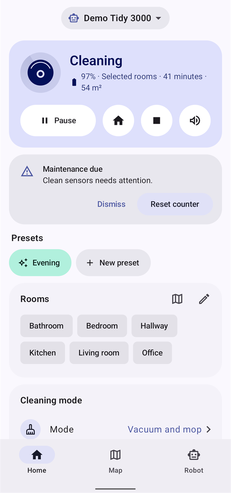
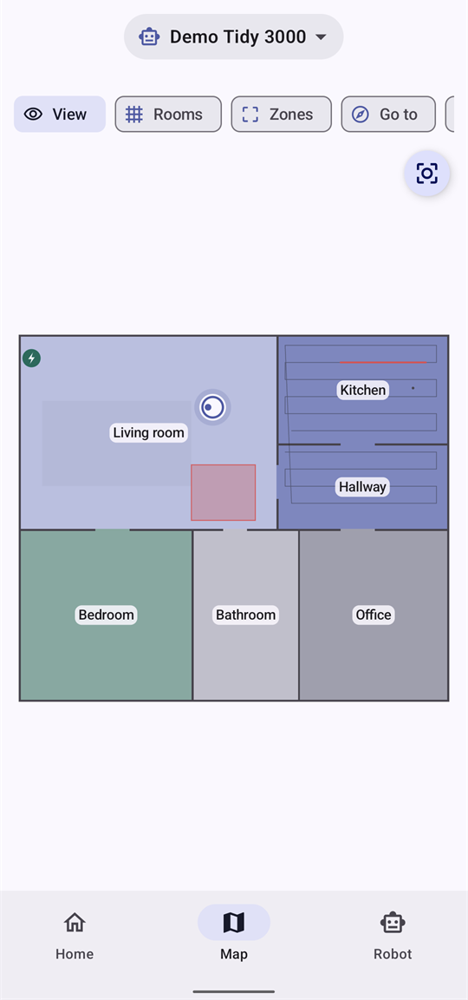
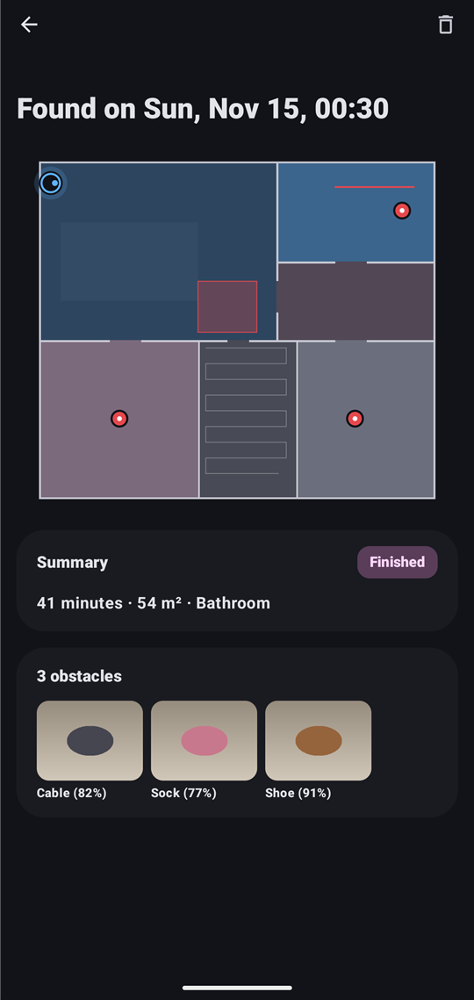
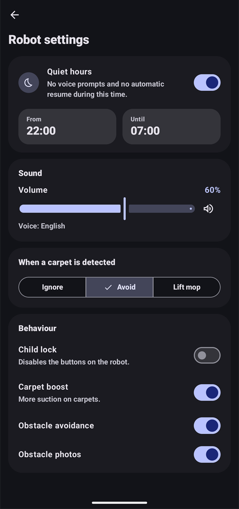
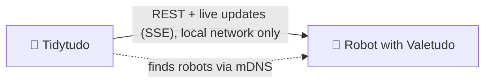

<p align="center">
  
</p>

<h1 align="center">Tidytudo</h1>

<p align="center">
  <b>A fast, native Android app for robot vacuums running Valetudo. No cloud, no Google services.</b><br>
  Made for /e/OS, LineageOS, GrapheneOS and every other de-Googled Android.
</p>

<p align="center">
  <a href="LICENSE"></a>
  
  
  
  
</p>

<p align="center">
  
  
  
  
</p>

---

## Why?

[Valetudo](https://valetudo.cloud) frees robot vacuums from their vendor's cloud. It comes with a
good web interface, but on a phone a browser tab is not the nicest way to start a cleaning on
the way out, and it cannot show a widget, a notification or a quick-settings tile.

Tidytudo is a native client for Valetudo's local API. It talks only to the robots you add, on
your own network. It needs no account, no server and no Google Play Services, and it collects
nothing.



## Features

- **Finds your robot** on the network (mDNS, with a subnet scan as fallback), or connect by address
- **Live status**: battery, what the robot is doing, errors in plain language, dock and attachment state
- **One-tap control**: start, pause, stop, dock, locate, with only the actions that make sense right now
- **Rooms and presets**: clean selected rooms with passes, save room and mode combinations as presets
- **Map**: rooms, walls, path, robot and dock, pinch-zoom; select rooms, draw zones, send the robot to a point, edit no-go and no-mop areas and virtual walls, rename rooms
- **Cleaning history**: every run with its map, duration, area, rooms and the photos of obstacles the robot recognised. Valetudo keeps none, so Tidytudo records it on your phone
- **Care**: consumables with remaining life and reset, messages from the robot
- **Schedules** in your local time (Valetudo stores UTC), with rooms and suction/water/mode per timer
- **Settings** the robot reports: quiet hours, volume, carpet behaviour, child lock, obstacle avoidance and more
- **Android extras**: home-screen widget, quick-settings tile, cleaning notification with pause/dock, alerts on errors and maintenance, launcher shortcuts for rooms and presets
- **Several robots**, each with its own name in the app
- **Only what your robot can do**: everything follows the robot's capabilities, nothing is hard-coded for a vendor or model
- English and German, light and dark theme, Material You colours

## Requirements

| | |
|---|---|
| Phone | Android 12 or newer, no Google services needed |
| Robot | Running Valetudo with the `/api/v2` interface; tested with Valetudo 2026.08.0 on a Dreame X40 Ultra |
| Network | Phone and robot on the same network (or a VPN into it) |

The full list of requirements with their verification status is in
[docs/requirements/req42.md](docs/requirements/req42.md). ✅ means verified on a real robot,
🔬 means implemented but so far only verified against the mock server.

## Getting started

1. Install Tidytudo (F-Droid, or the APK from the [releases](https://github.com/DWicki/Tidytudo/releases)).
2. Open it. Robots on your network appear by themselves; tap yours.
   If none appears, tap **Scan the network** or type the address (for example `192.168.1.20`).
3. If you set a password in Valetudo, the app asks for it. With HTTPS and a self-signed
   certificate, compare the fingerprint and confirm it once.
4. Optionally allow background recording, so the history keeps every cleaning.

## FAQ

**Does Tidytudo work when I am away from home?**
Only through a VPN into your home network (WireGuard, Tailscale and similar). Tidytudo never
talks to anything on the internet, and plain HTTP is refused to anything outside private
address ranges.

**Why does the history miss a cleaning?**
Valetudo keeps only the latest run, and on the tested robot the map with path, obstacles and
photos disappeared a few hours after cleaning. Tidytudo saves a run whenever it connects, so
open the app after cleanings or turn on **Alerts in the background** in App settings, which
saves every run the moment the robot docks.

**What does background recording cost?**
One of the robot's five live-update connections and a quiet, permanent notification. The
connection is idle except when the robot reports something; battery use has not been measured yet.

**My robot shows a capability as "not supported by this app yet".**
Valetudo grows faster than any client. The info screen lists those capabilities; please open an
issue with the name so it can be added.

**Is this an official Valetudo app?**
No. It is an independent project, see the note at the end.

## Building

You need JDK 17 (Temurin; OpenJ9 crashes Gradle) and the Android SDK with platform 35.

```bash
./gradlew :app:assembleDebug           # debug APK
./gradlew :app:testDebugUnitTest       # unit tests
./gradlew :app:assembleRelease         # release APK (R8), unsigned
```

For development and screenshots without a robot, run the mock server and connect the app to
`127.0.0.1:8080` after `adb reverse tcp:8080 tcp:8080`:

```bash
python3 tools/mock-valetudo/mock_valetudo.py
```

## How the code is organised

| Package | Contents |
|---|---|
| `api` | HTTP client, server-sent events, typed models, capability registry, live robot sessions, certificate pinning |
| `map` | Map parser, geometry, bitmap rendering and the Compose map canvas with gestures |
| `discovery` | mDNS browsing and the subnet scan |
| `data` | Robot list, encrypted credentials, settings; `data.history` records and stores cleaning runs |
| `service`, `widget`, `tile`, `shortcuts` | Android entry points outside the main screen |
| `ui` | Screens, one view model per screen, theme and shared components |
| `util` | Log redaction, address rules, time conversion |

## Documentation

- [Valetudo API notes](docs/valetudo-api.md): the parts of the API the app relies on, as verified on a live robot
- [Requirements (req42)](docs/requirements/req42.md) with verification status
- [Architecture (arc42)](docs/architecture/arc42.md) with decisions and diagrams
- [Security and permissions](docs/security.md)
- [Mock server](tools/mock-valetudo/README.md)
- [Changelog](CHANGELOG.md)

## Privacy and security

- **No data leaves your phone except to your own robots.** No analytics, no crash reports, no
  ads, no update checks, no account.
- Valetudo passwords are encrypted with a key in the Android Keystore and never logged.
- Plain HTTP only to addresses on your own network; HTTPS with your own certificate after you
  confirmed its fingerprint.
- The cleaning history (maps and obstacle photos of your home) stays in the app's private storage
  and is excluded from backups.

Details and the reason for every permission: [docs/security.md](docs/security.md).

## Known limitations

- Commands that move the robot are verified against the mock server; on a real robot so far only
  reading data is verified (see req42 for the exact state).
- The history can only contain runs the app saw while the robot still had them.
- No voice pack download, Wi-Fi setup, manual driving, map editing beyond restrictions and names,
  MQTT or Valetudo updates. The Valetudo web interface covers these.
- Pinch-zoom on the map, widget, tile and shortcuts still need a manual test on hardware.

## License

GPL-3.0-or-later, see [LICENSE](LICENSE).

Tidytudo is an independent project. It is not affiliated with, endorsed by or connected to the
Valetudo project or its authors. "Valetudo" is used only to describe compatibility.

This app was built with AI assistance (Claude by Anthropic).
