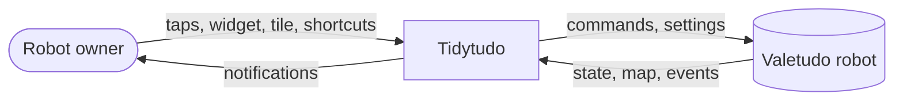
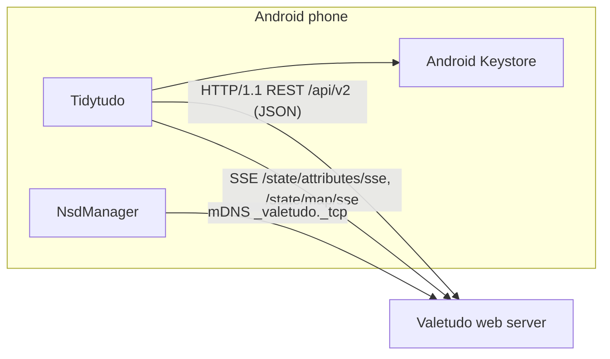
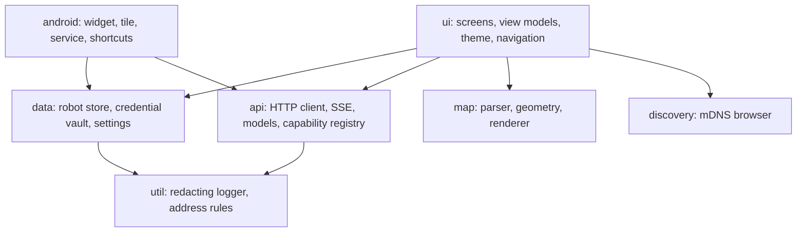
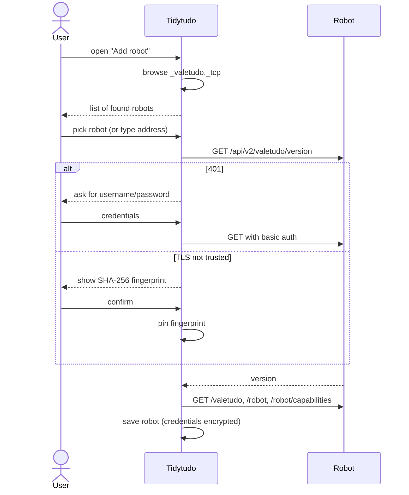
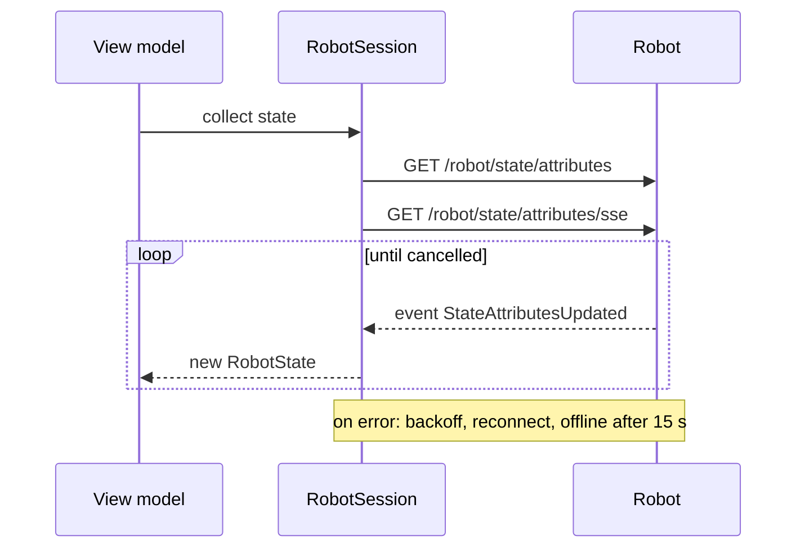
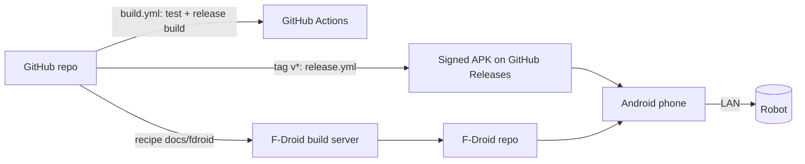
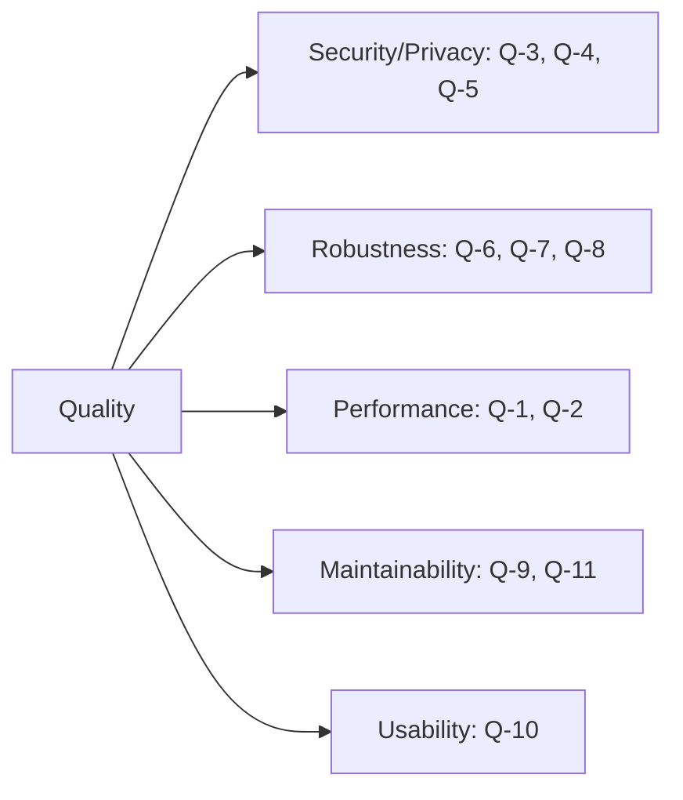

# Tidytudo: Architecture (arc42)

Structure follows the [arc42](https://arc42.org) template. Requirement IDs (`F-…`, `Q-…`,
`C-…`) refer to the [requirements (req42)](../requirements/req42.md). The robot protocol is
described in [valetudo-api.md](../valetudo-api.md).

---

## 1. Introduction and goals

Tidytudo is a native Android client for robot vacuums running Valetudo. It talks directly to the
robot's local REST API and server-sent event (SSE) streams. There is no backend of our own.

### 1.1 Top quality goals

| Priority | Goal | Scenario |
|---|---|---|
| 1 | Usability (Q-10, G-1) | Daily tasks in ≤ 2 taps; only actions that make sense now are offered; confirmations before anything irreversible |
| 2 | Privacy and security (Q-3, Q-4, Q-5) | Credentials are unreadable without the device's Keystore; traffic goes only to robots; history stays on the phone |
| 3 | Robustness and compatibility (Q-6, Q-7) | Unknown capabilities or a new Valetudo version degrade gracefully |
| 4 | Responsiveness (Q-1, Q-2) | Live state within 2 s; smooth map |
| 5 | Maintainability (Q-9) | Parser and client are unit-tested without a robot |

### 1.2 Stakeholders

See [req42 §2](../requirements/req42.md#2-stakeholders).

## 2. Constraints

| Constraint | Consequence |
|---|---|
| No GMS / proprietary code (C-1) | mDNS via platform `NsdManager`; no Firebase push, so notifications come from a local foreground service |
| Few libraries (C-3) | No DI framework, no Room, no DataStore, no Glance, no image library. Manual wiring through an `AppContainer`; JSON files for storage; `RemoteViews` widget |
| minSdk 31 | Material You dynamic colour always available; `SplashScreen` platform API; exact `PendingIntent` mutability flags |
| F-Droid reproducibility (Q-11) | Pinned versions in `gradle/libs.versions.toml`; no VCS info, no dependency blob, no timestamps |

## 3. Context and scope

### 3.1 Business context



### 3.2 Technical context



| Channel | Protocol | Notes |
|---|---|---|
| REST | HTTP or HTTPS, optional basic auth | Cleartext only to private addresses (Q-4) |
| Live state | SSE (`text/event-stream`) | Max. 5 clients per hub on the robot; we use 1 attribute stream per robot |
| Discovery | mDNS / DNS-SD | Manual entry as fallback |

## 4. Solution strategy

- **Capabilities drive the UI.** A `CapabilityRegistry` maps capability names to features. Screens
  ask "does the active robot have X?" and never check vendor or model (G-2).
- **One session per robot.** A `RobotSession` owns the HTTP client, the attribute SSE stream and
  the derived `StateFlow`s. Screens collect flows; commands go through the session.
- **Pure parsers.** Map and state parsing are plain Kotlin functions over `JsonElement`, separate
  from Android, so they run in JVM unit tests with recorded fixtures.
- **Fail soft.** Unknown classes, enum values and capabilities become "unknown" values; nothing
  in the protocol layer throws for data we don't understand.
- **Local-only background work.** An opt-in foreground service keeps one SSE stream open to
  post local notifications. Without it, the app is silent when closed.

## 5. Building block view

### 5.1 Level 1



| Package | Responsibility |
|---|---|
| `api` | `ValetudoClient` (typed REST calls), `SseStream`, models, `CapabilityRegistry`, `RobotSession`, TLS pinning |
| `map` | `MapParser` (JSON → `RobotMap`), coordinate transforms, `MapCanvas` composable and drawing |
| `discovery` | `RobotDiscovery` wrapping `NsdManager` as a `Flow` |
| `data` | `RobotStore` (robot list as JSON file), `CredentialVault` (Keystore AES-GCM), `AppSettings` |
| `data.history` | `SessionRecorder` (turns observed status changes into runs), `HistoryStore` (index plus one folder per run with gzipped map and photos) |
| `ui` | Navigation graph, one view model per screen/feature, theme, reusable components |
| `service`, `widget`, `tile`, `shortcuts` | Android entry points outside the activity |
| `util` | `Log` redaction, private address checks, time conversion |

### 5.2 Level 2: key building blocks

| Block | Interface | Notes |
|---|---|---|
| `ValetudoClient` | suspend functions returning `ApiResult<T>` | One OkHttp client per robot (own trust manager when pinned); 10 s call timeout |
| `SseStream` | `fun events(path): Flow<SseEvent>` | Minimal SSE line parser on OkHttp; no extra library |
| `RobotSession` | `state: StateFlow<RobotState>`, `capabilities`, `send(command)` | Reconnects with backoff 1 s → 30 s; marks robot offline after 15 s without data |
| `SessionManager` | `session(robotId)` | Keeps sessions alive while used by UI, service, widget |
| `MapParser` | `parse(json): RobotMap` | Decompresses run-length pixels; tolerant of unknown entities |
| `CapabilityRegistry` | `features(capabilities): Set<Feature>` | Knowledge of which names the app understands |

## 6. Runtime view

### 6.1 Add a robot



### 6.2 Live state



### 6.3 Clean selected rooms

User taps rooms on the map → view model collects segment ids → `PUT
MapSegmentationCapability {"action":"start_segment_action", …}` → optimistic "starting" state →
next SSE update confirms `cleaning` / `segment`.

### 6.4 Recording a cleaning run (F-8)

```mermaid
sequenceDiagram
    participant S as RobotSession
    participant R as SessionRecorder
    participant V as Robot
    participant H as HistoryStore
    S-->>R: observedState: status cleaning
    R->>V: GET /robot/state/map (active rooms)
    S-->>R: observedState: error (message kept)
    S-->>R: observedState: docked / idle (not resumable)
    Note over R: settle 5 min; any work, resumable flag or lost connection cancels it
    R->>V: GET /robot/state (still resting?)
    R->>V: GET /robot/state/map (with path, obstacles)
    R->>V: GET CurrentStatisticsCapability
    R->>H: add, or replace the entry whose path the robot continued
    loop each obstacle with an id (max 60), one worker per robot
        R->>V: GET ObstacleImagesCapability/img/{id}
        R->>H: attachImage
    end
```

`JobTracker` holds the rules (when a job begins, when a rest counts, errors); the recorder runs the
settle timers and storage. Short stops at the dock during a job last seconds, so a fixed settle
time separates them from the end of a job; a mid-job recharge is reported as `resumable`.

The recorder collects `RobotSession.observedState`, which does not start a stream. It therefore
only sees runs while the UI, the widget/tile or the monitoring service keeps the connection open.

### 6.5 Background notification

The opt-in `MonitorService` (foreground, type `specialUse`) holds one session per robot. On a
transition into `error`, or a new depleted-consumable event, it posts a notification. While a
robot is `cleaning`, it shows an ongoing notification with pause/dock actions; it stops itself
when no robot is cleaning and monitoring is off.

## 7. Deployment view



## 8. Cross-cutting concepts

### 8.1 Domain model

`Robot` (id, address, nickname, system id, trust pin, has credentials) → `RobotState` (status,
battery, presets, attachments, dock, error) and `RobotMap` (layers, segments, entities) →
`Capability` set. Commands are typed (`RobotCommand.Start`, `CleanSegments(ids, iterations)`, …).

### 8.2 Security concept

| Topic | Decision |
|---|---|
| Credentials | Basic-auth password encrypted with AES-256-GCM, key in Android Keystore (non-exportable), stored in `files/vault.json`; `android:allowBackup` rules exclude `vault.json` and `robots.json` |
| Cleartext | Manifest network security config allows cleartext (Android cannot express IP ranges). A network interceptor checks the *resolved* socket address and refuses plain HTTP unless it is loopback, link-local, site-local (RFC 1918) or IPv6 ULA (`fc00::/7`). Resolving first stops DNS names that point to public addresses |
| Self-signed TLS | Per-robot trust manager: system trust first; else the leaf certificate's SHA-256 must equal the pinned value. Unpinned failures surface the fingerprint for user confirmation. With a pin, the hostname check is skipped because the pin binds the exact certificate |
| Logging | All log output goes through `RedactingLog`, which drops credentials, replaces IPs, host names and URLs with placeholders and never logs map coordinates. Release builds log warnings and errors only |
| Permissions | `INTERNET`, `ACCESS_NETWORK_STATE` (own subnet for the scan), `POST_NOTIFICATIONS`, `FOREGROUND_SERVICE` + `FOREGROUND_SERVICE_SPECIAL_USE` (monitor), `RECEIVE_BOOT_COMPLETED` (restart monitoring after a reboot if the user enabled it). mDNS goes through the platform's `NsdManager`, so no multicast permission is needed. Each permission is justified in `docs/security.md` |
| History data | Maps and obstacle photos show the inside of the home. They stay in private app storage, are excluded from backup and device transfer, are capped at 50 runs per robot and are deleted with the robot |

### 8.3 Error handling

`ApiResult` is `Success`, `HttpError(code, body)`, `NetworkError(cause)`, `AuthRequired`,
`UntrustedCertificate(fingerprint)`. View models map these to translated messages. A `400` on
a known capability is shown as "this Valetudo version handles that differently" (F-1.8).

### 8.4 Internationalisation

All strings in `values/strings.xml` and `values-de/strings.xml`, plurals via `<plurals>`,
`locales_config.xml` for per-app language. Enum values from the robot (status, consumable
types, capability names) are mapped to string resources; unknown values are humanised
(`water_tank_clean` → "Water tank clean").

### 8.5 Offline behaviour

The robot list and the last known state are shown immediately. A session that cannot reach its
robot shows "offline since …" and keeps retrying with backoff while visible. Commands are not
queued: a failed command shows an error with a retry action.

### 8.6 UX concept

Material 3 with dynamic colour and a fixed midnight-indigo brand colour when dynamic colour is
off. Home screen = status card + main actions + presets; map is a separate tab; settings are
grouped by capability.

## 9. Architecture decisions

| ADR | Decision | Reason |
|---|---|---|
| ADR-1 | No dependency injection framework | Few classes; an `AppContainer` keeps wiring visible and avoids annotation processing |
| ADR-2 | Own SSE parser instead of `okhttp-sse` | The format is simple, and the library would add an artifact for ~60 lines of code |
| ADR-3 | JSON files instead of Room/DataStore | Small data (a few robots); kotlinx.serialization is already present (C-3) |
| ADR-4 | Map rendered as a cached bitmap for pixels + vector entities | Pixel layers change rarely; drawing 10⁵ rects per frame would miss Q-2 |
| ADR-5 | `RemoteViews` widget instead of Glance | Avoids an extra library; the widget is simple |
| ADR-6 | Opt-in foreground service for notifications | No push service (C-1); Android kills background SSE without a foreground service |
| ADR-7 | Cleartext check on resolved address | Network security config cannot express IP ranges |
| ADR-8 | GPL-3.0-or-later | Same as the author's other app; compatible with talking to an Apache-2.0 server (no code taken) |
| ADR-9 | History is recorded passively from observed state | Valetudo has no history API. Opening a stream just for recording would cost one of the robot's five SSE slots permanently and keep the phone awake; recording what the app follows anyway, plus opt-in monitoring, is the honest trade-off |
| ADR-10 | Notification permission asked when the first job starts | A prompt at app start has no context and is often denied; at the first start the benefit (progress notification) is obvious |

## 10. Quality requirements

### 10.1 Quality tree



### 10.2 Scenarios

| Scenario | Expected response |
|---|---|
| Robot updated to a Valetudo version with a new capability | Capability listed as "not yet supported"; everything else works |
| Map JSON contains an unknown entity type | Entity skipped; the rest is drawn |
| User types `http://example.com` | Rejected before sending: "plain HTTP only for local addresses" |
| Robot certificate changes after pinning | Connection refused with a clear message and an option to re-pin |
| Wi-Fi drops while the app is open | "Offline" shown within 15 s; recovers within 10 s after Wi-Fi returns |

## 11. Risks and technical debt

| Risk | Mitigation |
|---|---|
| Valetudo changes the API (it is versioned only as `v2`) | Tolerant parsing, version shown, tests with recorded fixtures |
| Only one robot model available for hardware tests | Mock server with a second, different capability set; 🔬 status for unverified features |
| SSE client limit (5) shared with the web UI and Home Assistant | One stream per robot; map stream only while visible |
| mDNS blocked on some networks or by Android multicast filtering | Multicast lock during browse; manual entry always available |

## 12. Glossary

See [req42 §7](../requirements/req42.md#7-glossary).
