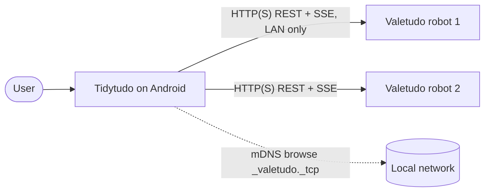

# Tidytudo: Requirements (req42)

Structure follows the [req42](https://req42.de) framework. Requirement IDs (`G-…`, `F-…`, `Q-…`,
`C-…`) are stable and are referenced from the [architecture (arc42)](../architecture/arc42.md),
from commit messages and from code comments. Postponed requirements stay in this file as ⏳.

Status legend: ✅ implemented and verified on real hardware · 🟡 partially implemented ·
⏳ not implemented · 🔬 implemented, **not yet verified on real hardware**.

---

## 1. Business goals / vision

**Vision:** People with a de-Googled phone who run their robot vacuum on Valetudo get a fast,
calm, native app for daily use, without a browser tab and without any cloud.

| ID | Goal | Measure |
|----|------|---------|
| G-1 | Native daily control of Valetudo robots | Start, pause, dock and room cleaning reachable in ≤ 2 taps from launch |
| G-2 | Works on any Valetudo robot | No vendor or model is hard-coded; UI driven only by reported capabilities |
| G-3 | Privacy | No traffic except to the robots the user added |
| G-4 | Free software | GPL-3.0-or-later, F-Droid compatible, reproducible build |
| G-5 | Several robots | Any number of robots, switchable in one tap |

## 2. Stakeholders

| Role | Expectation |
|------|-------------|
| Robot owner on /e/OS, LineageOS, GrapheneOS | Quick control, room cleaning, clear messages when the robot needs help |
| Household members | Widget / tile to start or dock without understanding the app |
| Valetudo power user | Access to the robot's settings that the web UI offers, and to robot info |
| Valetudo maintainers | Clean, read-mostly API use; no load on the robot from aggressive polling |
| F-Droid packagers | Only free dependencies, reproducible build, metadata in the repo |
| Contributors | Readable, documented, tested code; documented protocol |

## 3. Scope and context

**In scope:** discovering and connecting to Valetudo robots on the local network, live state,
control, map display and map-based commands, consumables, schedules, settings that are
reported as capabilities, Android extras (widget, tile, notifications, shortcuts).

**Out of scope:** installing or rooting Valetudo, firmware/Valetudo updates, Wi-Fi provisioning,
MQTT, remote access from outside the home network (users can use their own VPN), editing room
boundaries (split/merge), manual remote driving.

## 4. Functional requirements

### F-1 Robots and connection

| ID | Requirement | Status |
|----|-------------|--------|
| F-1.1 | Discover robots on the LAN via mDNS (`_valetudo._tcp`) and show model and name from TXT records | ✅ (Fairphone 6, Valetudo 2026.08.0) |
| F-1.2 | Add a robot manually by host name, IP address or URL (with optional port) | 🔬 (works on the phone against the mock server; not yet on the real robot) |
| F-1.3 | Check the address before saving: reachable, is Valetudo, version shown | ✅ (Fairphone 6, Valetudo 2026.08.0) |
| F-1.4 | HTTP basic auth: ask on `401`, store credentials encrypted (see Q-3) | 🔬 |
| F-1.5 | HTTPS with self-signed certificates: show SHA-256 fingerprint, pin it after user confirmation, refuse on change | 🔬 |
| F-1.6 | Several robots: list, switch, rename (local nickname), remove | 🔬 (switching and adding verified on the phone; rename and remove not yet) |
| F-1.7 | Recognise a robot by its Valetudo system id when its address changes | 🔬 |
| F-1.8 | Clear message when a robot runs a Valetudo version that is too old (no `/api/v2`) | 🟡 (generic "not supported" message; no explicit version check yet) |
| F-1.9 | Fallback discovery when mDNS finds nothing: scan the phone's own Wi-Fi subnet (max. /24, private addresses only) for `GET /api/v2/valetudo/version` | 🔬 |

### F-2 Live state and basic control

| ID | Requirement | Status |
|----|-------------|--------|
| F-2.1 | Show status (docked, cleaning, …) with flag (zone, segment, …), battery level and charging state | ✅ (Fairphone 6, Valetudo 2026.08.0) |
| F-2.2 | Live updates via SSE; reconnect automatically; show "offline" after the connection is lost | 🔬 (initial state and reconnect on the real robot, live changes only seen with the mock) |
| F-2.3 | Start, stop, pause, return to dock (`BasicControlCapability`) with only the actions that make sense for the current status | 🔬 (works on the phone against the mock server; not yet on the real robot) |
| F-2.4 | Locate the robot (`LocateCapability`) | 🔬 (works on the phone against the mock server; not yet on the real robot) |
| F-2.5 | Fan speed, water usage and operation mode presets, showing only presets the robot reports | 🔬 (presets shown correctly on the real robot; changing them only tested with the mock) |
| F-2.6 | Show attachments and dock components (mop attached, water tanks, dust bag) and dock status | ✅ (Fairphone 6, Valetudo 2026.08.0; attachments added in the refactor pass, shown with the mock) |
| F-2.7 | Show robot errors in plain language (message, subsystem, severity) | 🔬 |
| F-2.8 | Dock actions: empty dust bin, clean mop, dry mop (manual trigger capabilities) | 🔬 |

### F-3 Map

| ID | Requirement | Status |
|----|-------------|--------|
| F-3.1 | Parse the Valetudo map (layers with compressed or plain pixels, entities) in a separate, unit-tested parser | ✅ (Fairphone 6, Valetudo 2026.08.0) |
| F-3.2 | Render floor, walls, rooms (distinct colours), path, robot with heading, charger, no-go / no-mop areas, virtual walls, obstacles | ✅ (Fairphone 6, Valetudo 2026.08.0) |
| F-3.3 | Pan and pinch-zoom; double-tap to reset | 🔬 (fit-to-screen verified; pinch-zoom needs a manual test) |
| F-3.4 | Live map updates via SSE while the map is visible | 🔬 |
| F-3.5 | Room labels drawn on the map | ✅ (Fairphone 6, Valetudo 2026.08.0) |

### F-4 Cleaning modes

| ID | Requirement | Status |
|----|-------------|--------|
| F-4.1 | Room cleaning: tap rooms on the map or pick from a list, choose iterations and order (if supported) | 🔬 (room selection on the real map verified; starting a room cleaning only tested with the mock) |
| F-4.2 | Zone cleaning: draw up to the reported number of rectangles, resize/move, iterations | 🔬 (works on the phone against the mock server; not yet on the real robot) |
| F-4.3 | Go to location: tap a point on the map | 🔬 (works on the phone against the mock server; not yet on the real robot) |
| F-4.4 | Edit no-go areas, no-mop areas and virtual walls and save them | 🔬 (works on the phone against the mock server; not yet on the real robot) |
| F-4.5 | Rename rooms (`MapSegmentRenameCapability`): select one room on the map, then "Rename room" | 🔬 (works on the phone against the mock server; not yet on the real robot) |
| F-4.6 | Presets: save a set of rooms + fan/water/mode as a named preset and start it in one tap | 🔬 (works on the phone against the mock server; not yet on the real robot) |

### F-5 Maintenance and information

| ID | Requirement | Status |
|----|-------------|--------|
| F-5.1 | Consumables with remaining time/percentage and reset (with confirmation) | 🔬 (values verified on the real robot; reset only tested with the mock) |
| F-5.2 | Events list (errors, depleted consumables, dust bin full, pending map change) in plain language, with dismiss / reset / accept actions | 🔬 (messages verified on the real robot; dismiss/reset only tested with the mock) |
| F-5.3 | Robot info: manufacturer, model, firmware, Valetudo version, host info, capability list incl. unknown ones | ✅ (Fairphone 6, Valetudo 2026.08.0) |
| F-5.4 | Statistics: current and total time, area, count | ✅ (Fairphone 6, Valetudo 2026.08.0) |
| F-5.5 | Accept or reject a pending map change | 🔬 |

### F-6 Schedules and settings

| ID | Requirement | Status |
|----|-------------|--------|
| F-6.1 | List, create, edit, enable/disable, delete and run timers; convert UTC to local time | 🔬 (list and UTC conversion verified on the real robot; create/delete only tested with the mock) |
| F-6.2 | Timer actions: full cleanup and room cleanup with pre-actions (fan, water, mode) where supported | 🔬 |
| F-6.3 | Do-not-disturb window | 🔬 (window and UTC conversion verified on the real robot; changing it not yet) |
| F-6.4 | Speaker volume with test sound | 🔬 (volume shown correctly on the real robot; changing it not yet) |
| F-6.5 | Voice pack: show current language and operation status | 🟡 (shows language and status; download needs a voice pack URL, out of scope for 1.0) |
| F-6.6 | Generic switches for all `…ControlCapability` toggles the robot reports (carpet mode, key lock, obstacle avoidance, …) with translated names; unknown switches show their class name | 🔬 (switch states verified on the real robot; toggling only tested with the mock) |
| F-6.7 | Carpet sensor mode and other enum-style settings where the API is known | 🔬 |

### F-7 Android integration

| ID | Requirement | Status |
|----|-------------|--------|
| F-7.1 | Home-screen widget: status, battery, start/pause and dock buttons for a chosen robot | 🔬 |
| F-7.2 | Quick-settings tile: shows status, tap toggles start/pause; long-press opens the app | 🔬 |
| F-7.3 | Ongoing notification while cleaning with progress information and pause/dock actions | 🔬 (works on the phone against the mock server; not yet on the real robot) |
| F-7.4 | Local notification on error, stuck robot or depleted consumable (only while monitoring runs; no push service) | 🔬 |
| F-7.5 | Launcher shortcuts for rooms and presets | 🔬 |
| F-7.6 | Per-app language (English, German) via Android 13+ system settings and in-app setting | 🔬 |

### F-8 Cleaning history

Valetudo keeps no history of cleaning runs, so the app records them itself.

| ID | Requirement | Status |
|----|-------------|--------|
| F-8.1 | Record each cleaning run: afterwards from what the robot still holds whenever the app connects, and live (with exact times and errors) when the app sees it happen; never store a run twice | 🟡 (afterwards: verified on the real robot; the robot discards path and obstacles a few hours after a run, so runs can be missed without background monitoring. Live: works against the mock) |
| F-8.2 | Store the map at the end of the run, with the driven path, and derive the rooms from the path | ✅ (Fairphone 6, Valetudo 2026.08.0) |
| F-8.3 | Store the obstacles of the run with label and photo, paced to Valetudo's rate limit and completed on later connections | 🔬 (labels verified on the real robot; only 9 of 45 photos were fetched before pacing was added, pacing tested with the mock) |
| F-8.4 | History list and detail view: map with tappable obstacle pins, summary, errors, photo gallery; delete a run | ✅ (Fairphone 6, Valetudo 2026.08.0) |
| F-8.5 | Keep history on the phone only, excluded from backups; keep the newest 50 runs per robot | ✅ (unit-tested; backup exclusion in `data_extraction_rules.xml`) |
| F-8.6 | After the first robot is added, offer background recording once, with its trade-offs (one robot connection, a quiet notification); also switchable in App settings; keep it running after app updates and reboots | 🔬 (dialog, switch and restart after an app update verified on the phone; restart after reboot not tested) |

## 5. Quality requirements

| ID | Quality | Acceptance criterion | Status |
|----|---------|----------------------|--------|
| Q-1 | Responsiveness | Cold start to live state in ≤ 2 s on a mid-range phone on the same Wi-Fi; command feedback ≤ 300 ms (optimistic UI) | 🔬 |
| Q-2 | Map performance | A 100 kB map with 11 rooms renders at ≥ 50 fps during pan/zoom on a mid-range phone | 🔬 |
| Q-3 | Credential security | Basic-auth passwords are encrypted with an Android Keystore AES-GCM key, excluded from backups and never appear in logs (unit test on the log redactor) | 🔬 |
| Q-4 | Transport security | Cleartext only to private/link-local addresses and `.local` names; HTTPS to self-signed hosts only with a pinned fingerprint | 🔬 |
| Q-5 | Privacy | Network traffic only to user-added robot hosts; no analytics, no crash reporter, no update check (dependency review + `INTERNET` is the only network use) | 🔬 |
| Q-6 | Robustness | Losing Wi-Fi, a robot reboot or an unknown capability never crashes the app; recovery without restart within 10 s after the robot is back | 🔬 |
| Q-7 | Compatibility | Unknown `__class` values, unknown capabilities and unknown enum values are shown or ignored, not fatal (parser tests) | ✅ (parser tests with unknown classes/values) |
| Q-8 | Robot friendliness | At most one attribute SSE stream per robot; map SSE only while visible; no polling faster than every 30 s | 🔬 |
| Q-9 | Maintainability | Unit tests for API client, parsers and URL/credential handling; all pass before every commit | ✅ (38 unit tests, run before every commit) |
| Q-10 | Accessibility | All controls have content descriptions; touch targets ≥ 48 dp; works with 200 % font size | 🔬 |
| Q-11 | Reproducibility | Release build has no VCS info, no dependency blob, pinned dependency versions | 🔬 |

## 6. Constraints

| ID | Constraint |
|----|------------|
| C-1 | No Google Play Services, Firebase, proprietary libraries, analytics, ads or update checks |
| C-2 | Kotlin, Jetpack Compose, Material 3, minSdk 31, targetSdk 35, JDK 17 (Temurin) |
| C-3 | Libraries limited to AndroidX, OkHttp, kotlinx.coroutines, kotlinx.serialization |
| C-4 | UI in English and German |
| C-5 | Licence GPL-3.0-or-later; application id `io.github.dwicki.tidytudo` (permanent) |
| C-6 | Independent from the Valetudo project; no use of its logo or name as app name |

## 7. Glossary

| Term | Meaning |
|------|---------|
| Valetudo | Open-source, cloud-free replacement firmware layer for robot vacuums |
| Capability | A feature a robot reports, e.g. `ZoneCleaningCapability`; the contract between robot and client |
| Segment | Valetudo's word for a room on the map |
| SSE | Server-sent events, a one-way HTTP stream used for live updates |
| Pinning | Remembering a server certificate's fingerprint and accepting only that certificate |
